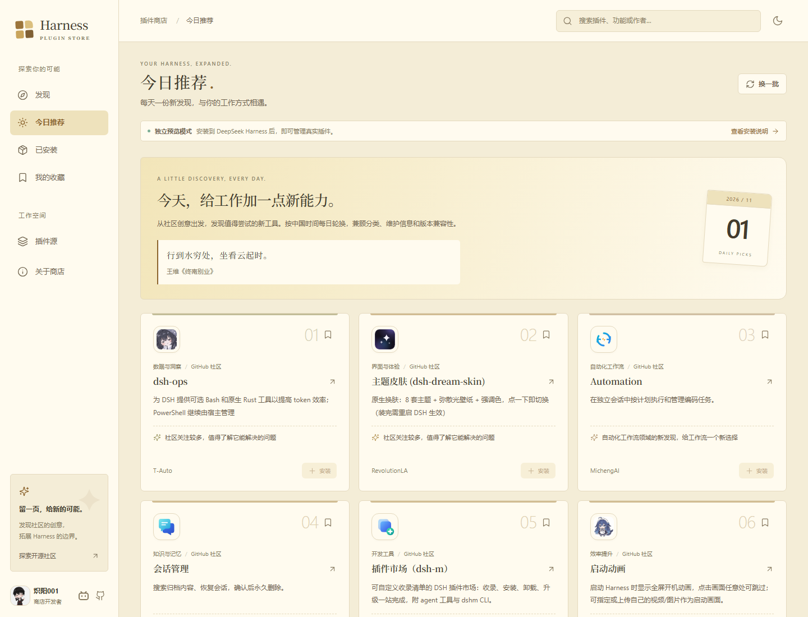
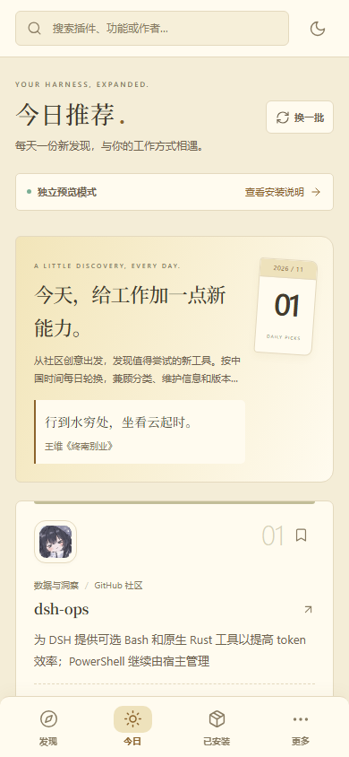

<p align="center"></p>

<h1 align="center">Harness 插件商店</h1>

<p align="center">发现社区好工具，也为灵感留一页。</p>

<p align="center">
  <a href="package.json"></a>
  <a href="LICENSE"></a>
  <a href="https://github.com/deepseek-ai/deepseek-harness"></a>
</p>

**Harness 插件商店**是由 [炽阳001](https://space.bilibili.com/404891612) 开发的 DeepSeek Harness 社区插件，把发现、搜索、收藏、安装与管理放在一个界面里。

以泛黄纸张、棕色墨迹和衬线标题构成界面，支持暖色深色主题与手机底栏。社区插件优先展示，每日推荐搭配一句古典诗词，让工具探索也有一点翻书的感觉。

[快速安装](#安装) · [功能介绍](#功能) · [安装镜像](#安装镜像与订阅源) · [本地开发](#本地开发) · [开发者](#开发者)

## 界面预览

下图来自项目的独立预览模式；安装与已安装状态以实际 Harness 宿主为准。


<details>
<summary>查看今日推荐与手机界面</summary>

<table>
  <tr>
    <th>今日推荐</th>
    <th>手机窄屏</th>
  </tr>
  <tr>
    <td width="72%"></td>
    <td width="28%"></td>
  </tr>
</table>

</details>

## 功能

| 功能 | 可以做什么 |
| --- | --- |
| 发现与搜索 | 按名称、描述、作者、标签、包名和仓库地址搜索；组合关键词，配合九类筛选、来源筛选和卡片 / 列表布局。 |
| 社区优先 | 首页与今日推荐展示非官方插件；全部插件中的官方条目始终放在末尾，切换排序或「换一批」后保持此规则。 |
| 今日推荐 | 按北京时间每日轮换，提供分类多样的社区发现；宿主版本可读取时，排除已知不符合版本声明的条目。 |
| 插件管理 | 读取真实宿主清单，安装、启用、停用、卸载及打开原生配置；「隐藏官方插件」默认开启并记住选择。 |
| 安装镜像 | 默认中国大陆 npm 镜像，也可选择 npm 官方源或自定义 HTTP / HTTPS 地址，安装前展示使用的源。 |
| 收藏与订阅 | 收藏感兴趣的插件，添加符合 DSH `format: 1` 的 HTTPS 插件索引。 |
| 原始图标 | 优先展示宿主、清单或插件仓库的原始 logo；资源缺失或加载失败时才使用分类占位。 |
| 每日诗词 | 内置 **730 条佳句**，来自 **597 篇作品、156 位诗人**，附作者与出处，无需联网获取。 |
| 手机适配 | 发现、今日、已安装、更多四项底栏；支持窄嵌入面板、横向分类筛选、底部安全区和触控弹窗。 |
| 主题与快捷键 | 浅黄纸张 / 暖色深色主题；`Ctrl / Cmd + K` 聚焦搜索，搜索框不显示快捷键提示。 |

当前内置目录快照包含 **860 个社区包**，其中 839 个位于仓库根目录、21 个来自子目录；141 个条目已收集到原始图标。这个数字描述内置快照，在线更新及订阅可继续补充，**不表示覆盖所有社区项目**。

九类筛选：开发工具、效率提升、知识与记忆、创作与设计、连接与集成、界面与体验、模型与推理、自动化工作流、数据与洞察。分类统一放在发现页，没有独立的分类页面。

## 安装

已验证宿主版本：**DeepSeek Harness 0.2.1-rc.5**。声明的兼容范围为 `>=0.2.1-rc.5 <0.3.0`，具体见 [package.json](package.json)。需要支持插件管理的 Web / Desktop 界面。

仓库已提交 `lib/` 预构建产物，安装插件本身无需先执行 `npm install` 或 `npm run build`。

### 方式一：通过 DSH CLI 安装

已有 `dsh` 命令、使用 Web profile 时：

```powershell
dsh plugin --profile web add github:Chiyang001/DSH_Plugin_Store
```

重启对应的 Harness 实例，在侧栏打开 **插件商店**。`web` 是示例 profile；自定义环境请使用它实际运行的 profile。

> 桌面版的 `desktop` profile 由 Electron 应用管理，CLI 直接修改它会被拒绝。桌面版可使用下方的本地接入方式。

### 方式二：桌面版本地接入

需要 Git 和 Node.js 22+。先关闭 Harness，再运行：

```powershell
git clone https://github.com/Chiyang001/DSH_Plugin_Store.git
cd DSH_Plugin_Store
node scripts/apply-desktop.mjs "$env:USERPROFILE/.dsh/profiles/desktop"
```

脚本把项目链接到指定的桌面 profile，并添加本插件的依赖及 bundle 条目，不下载其他插件依赖。重新打开 Harness 即可使用。

这是本地链接：使用期间请保留项目目录；移动目录后，需要重新运行接入脚本。若桌面 profile 不在默认位置，请把最后一个参数改为实际路径。

### 从本地目录安装到其他 profile

```powershell
# 将路径替换为本机项目的绝对路径
dsh plugin --profile web add "link:D:/Projects/DSH_Plugin_Store"
```

也可使用辅助脚本：

```powershell
powershell -ExecutionPolicy Bypass -File ./scripts/install.ps1 -Profile web
```

### 卸载

在 Harness 原生插件管理器中移除本插件。对于 CLI 管理的 profile，也可执行：

```powershell
dsh plugin --profile web remove dsh-plugin-store
```

## 使用方式

1. **先逛发现页**：用分类、关键词和来源缩小范围，或点击「换一批」继续探索。
2. **查看详情**：确认插件说明、仓库、版本要求、图标来源和安装目标。
3. **选择安装源**：在「插件源 → 插件安装源」里选择镜像并保存。
4. **确认安装**：安装框会显示插件来源和本次请求使用的镜像；结果由宿主插件管理器返回。
5. **管理工具箱**：到「已安装」启停或卸载插件；关闭「隐藏官方插件」可查看官方条目。开关只控制列表显示。

安装若需要重启、被宿主拒绝或受其他配置覆盖，界面会展示对应结果。插件版本更新按钮仅在宿主声明支持相应更新能力时出现。

每日诗词按北京时间轮换，当天刷新、重新打开页面或点击「换一批」都保持同一句；页面持续打开时也会自动更新。

## 安装镜像与订阅源

安装镜像和插件订阅是两种不同的设置：

| 设置 | 用途 |
| --- | --- |
| 插件安装源 | 下载 npm 插件及其依赖。默认 `https://registry.npmmirror.com/`；可切换 `https://registry.npmjs.org/` 或填写自定义地址，每次只启用一个。 |
| 插件订阅源 | 提供插件目录。支持允许跨域读取的 HTTPS DSH `format: 1` 索引；当前上限为 8 MB、5000 个条目。示例见 [examples/index.json](examples/index.json)。 |

自定义安装镜像支持端口和路径前缀。需要认证的私有源，请把凭据配置在本机 `.npmrc` 中。若订阅目录明确指定专用 npm 源，会优先使用目录中的地址，以兼容私有包。

GitHub 仓库本身仍通过 GitHub 下载；npm 镜像不会改写仓库地址。「插件源」页的「更新目录」会在线检索并合并新条目，发现页的「换一批」则直接轮换当前目录中的展示结果。

## 目录来源与数据

- 官方插件目录以**当前宿主**提供的数据为准；独立预览使用内置的官方元数据快照。
- 社区目录来自 GitHub 主题、名称与描述搜索、社区目录及明确的 monorepo 路径。条目需要在固定 Git 提交上具备 `dsh.bundle.patch` 声明。
- 在线搜索每轮最多核验 32 个候选，并轮换检索页；网络失败时保留现有目录。
- 收藏、主题、镜像、订阅地址及显示偏好保存在当前浏览器，不跨设备同步。

清单校验表示发现了插件声明，不等于代码安全审查或官方认证。兼容性、依赖安装和构建脚本审批由 Harness 宿主处理。

完整采集范围、规则和复现方法见 [目录来源说明](docs/CATALOG_SOURCES.md)。诗词、图标和其他第三方资源的来源及许可见 [THIRD-PARTY-NOTICES.md](THIRD-PARTY-NOTICES.md)。

## 本地开发

需要 Node.js 22+：

```powershell
npm ci
npm run dev
```

打开终端输出的本地地址。独立预览可使用搜索、分类、收藏、主题和源设置；真实安装与管理需要在 Harness 中运行。

### 检查与构建

```powershell
npm run typecheck
npm test
npm run build
npm run pack:plugin
```

`build` 生成宿主加载器使用的 `lib/client.js`，React 由宿主提供；`pack:plugin` 生成可分发的 `.tgz` 插件包。

### 界面验证

先保持 `npm run dev` 运行，在另一个终端执行：

```powershell
npx playwright install chromium
npm run test:ui
npm run test:discovery-ui
npm run test:layout
npm run test:registry-ui
npm run test:poetry-ui
npm run test:community-ui
```

验证覆盖搜索、收藏、安装参数传递、管理结果、跨午夜诗词轮换、社区优先及 320–740 px 的窄屏布局。真实安装测试仅应在隔离的测试 profile 上运行。

<details>
<summary>维护目录与文档图片</summary>

```powershell
# 合并更新社区目录
npm run catalog:refresh

# 重新收集并补全原始图标，需 Python
npm run catalog:collect

# 保持预览服务运行后，重新生成 README 图片
npm run docs:images
```

诗词库的构建脚本为 `scripts/collect-poetry.py`；它的转换工具依赖和来源说明写在脚本中。运行时直接读取已内置的诗词数据。

</details>

### 项目结构

```text
src/          React 界面、宿主适配、目录与诗词数据
lib/          已构建的 Harness 插件入口
docs/         来源说明、品牌图片与界面预览
scripts/      构建、接入、目录采集及验证工具
tests/        模型、适配器与界面测试夹具
examples/     插件索引格式示例
```

## 开发者

**炽阳001** · [Bilibili 主页](https://space.bilibili.com/404891612) · [GitHub 主页](https://github.com/Chiyang001?tab=repositories)

欢迎通过 [Issues](https://github.com/Chiyang001/DSH_Plugin_Store/issues) 反馈问题，或提交 Pull Request 改进界面、目录和宿主适配。

## 许可

本项目使用 [MIT License](LICENSE)。第三方插件、品牌标识、图标及诗词数据遵循各自的权利与许可，详见 [第三方声明](THIRD-PARTY-NOTICES.md)。
